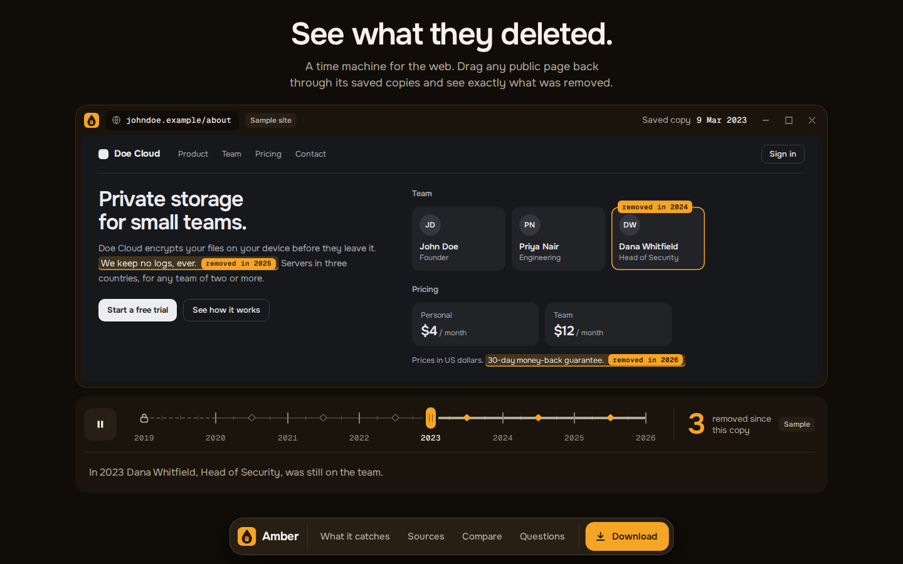
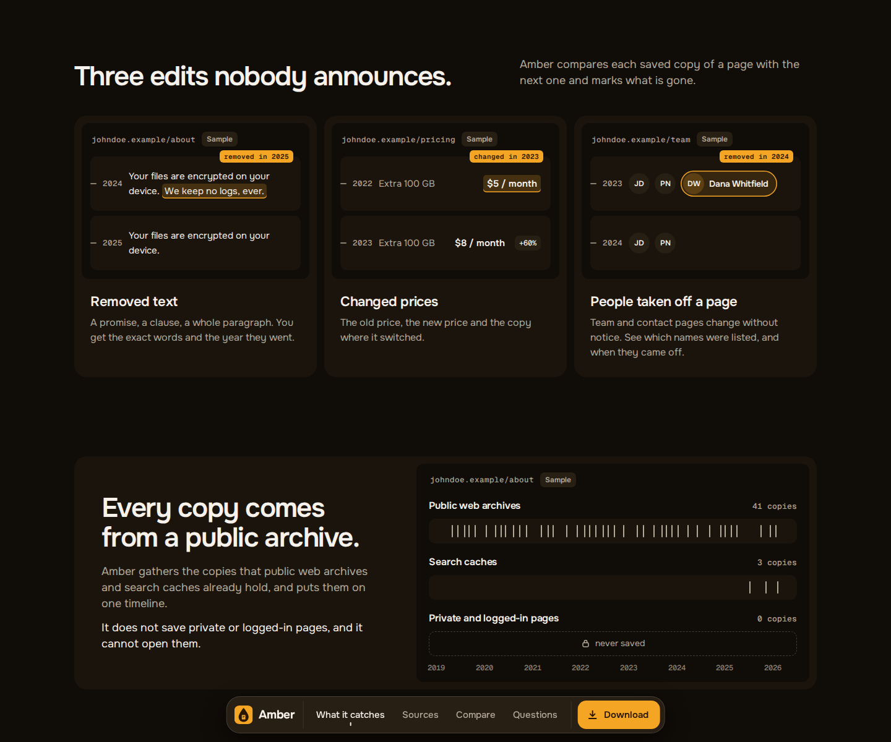
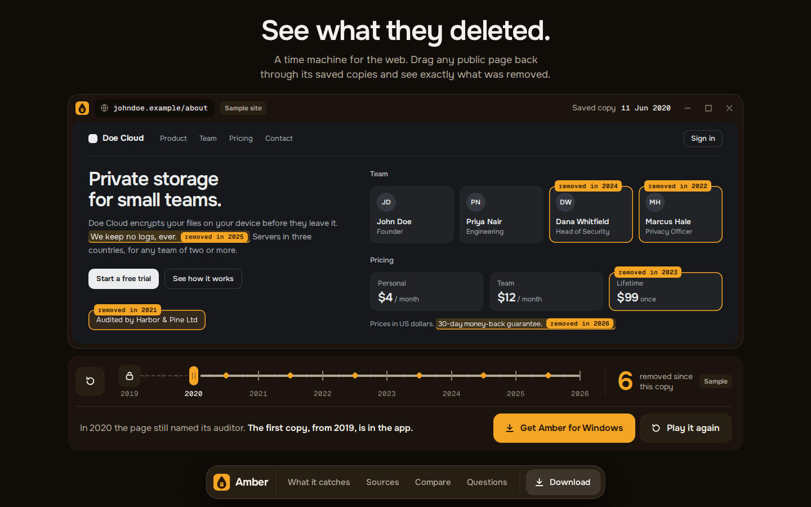

<h1 align="center">Amber: OSINT web archive viewer that shows what a page removed</h1>

<b>See what they deleted.</b> A time machine for the web: how any page looked at any point in the past, and what was changed or removed since.

OSINT · OSINT tool · web archive viewer · archived pages · page history · deleted content · website change tracking · snapshot diff · due diligence · windows

> **Status: v1.3.3.** The app is out — [download Amber for Windows](https://awesomeosint.tools/amber/).

## Why this exists

Pages change. A price list goes up, a licence paragraph quietly disappears, a "founded in 2009" turns into "founded in 2015". The archive kept the old copy.

## Why it is different

Archive viewers show one snapshot at a time. Amber puts two next to each other and marks every removal and every change, so the edit, not the page, is the headline.

## The idea

- **One object.** A drop of amber with a page caught inside it: the page preserved as it was.
- **One number.** How many things were removed from the page since the copy you are looking at.
- **Colour.** Resin black `#100C08` and warm white. Amber `#F5A524` marks what was removed, the time handle and the download.
- **The main feature.** "What they deleted": as you move through time, Amber marks exactly what was removed between two saved copies (a paragraph, a team member, a price) and the year it went.

## The demo on the page

The first screen is the player: a window with a saved copy of the sample page `johndoe.example/about` and a timeline under it. The handle starts on the newest copy and moves back a year at a time. Each step puts back something the page later removed, with an amber pin that says when ("removed in 2024"), and the count goes up: a guarantee, a "no logs" sentence, a team member, a plan, another team member, the auditor's name. After the run the handle can be dragged, or moved with the arrow keys. The run waits while the player is off screen or the tab is hidden; with reduced motion it opens in the final state.

It stops on the 2020 copy with six things marked. The first copy, from 2019, is locked on the timeline: the line under it says it is in the app, and the download button and "Play it again" appear.

